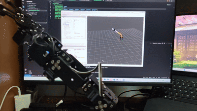

# 5-DOF Robotic Arm — RK3568 + STM32 异构控制系统

<div align="center">

### RViz 实时跟随实机关节状态



</div>

基于 **RK3568（ROS 2 Jazzy）+ STM32F407（FreeRTOS）** 的五自由度机械臂 + 夹爪控制系统。
两者通过 **CAN 2.0B（250 kbps）** 互联。

> 项目仍在持续更新，本 README 只记录已经跑通的功能。

## 硬件

| 部件 | 型号 | 数量 | 说明 |
|---|---|---|---|
| 上位机 | **RK3568**（KickPi K1Mini） | 1 | aarch64 Linux，ROS 2 Jazzy |
| 下位机 | **STM32F407VET6** | 1 | Cortex-M4 @168 MHz，FreeRTOS |
| 总线舵机 | **ZX20S** | 1 | ID **0** → `joint1`（底座旋转） |
| 总线舵机 | **ZX361S** | 5 | ID **1~5** → `joint2`~`joint5` + `gripper` |
| 总线 | CAN 2.0B | — | 250 kbps，`triple-sampling on` |
| 调试 | USB-CAN（可选） | 1 | 监听/抓包 |

### 舵机 ↔ 关节映射

| 舵机 ID | 型号 | 关节 | 运动轴 | 行程 |
|---|---|---|---|---|
| 0 | **ZX20S** | `joint1` | 绕 Z（底座旋转） | 500 ~ 2500 |
| 1 | ZX361S | `joint2` | 绕 Y（大臂俯仰） | 500 ~ 2500 |
| 2 | ZX361S | `joint3` | 绕 Y（小臂俯仰） | 500 ~ 2500 |
| 3 | ZX361S | `joint4` | 绕 Y（腕部俯仰） | 500 ~ 2500 |
| 4 | ZX361S | `joint5` | 绕 Z（腕部自转） | 500 ~ 2500 |
| 5 | ZX361S | `gripper` | 夹爪开合 | 0 ~ 2000 |

> ZX20S 与 ZX361S 的回复格式不同（温度单位、长度 11 B / 15 B）。
> 固件用 `#`…`!` 帧边界解析，不依赖固定长度。

## 已实现功能

### 上位机：RK3568 / ROS 2

- **`arm_server` 控制节点**：订阅 `/joint_commands`，发布 `/joint_states`；舵机位置与关节角双向映射，带方向矩阵和限位保护；请求-应答门控，避免命令灌爆下位机队列。
- **`ros2_control` 硬件接口**：`ArmSystemHardware` 插件，50 Hz 控制；`arm_controller`（joint1~5）+ `gripper_controller`，`joint_state_broadcaster` 发布状态。
- **MoveIt2 规划执行**：配套 `arm_ik_plugin`（5-DOF 解析逆解）、OMPL + Ruckig 平滑、`my_robot_arm_moveit_config`；支持三维坐标规划并驱动实机，实测 10/10 规划执行，末端平均误差约 11 mm。
- **RViz 可视化**：实时显示实机关节状态，可在 RViz 中拖动末端目标。
- **CAN 调试工具 `can_test`**：不依赖 ROS，直接读写 CAN，用于排查底层链路。
- **CAN 固件升级上位机**：接收 PC 通过 TCP 发来的 `.bin`，校验 CRC 后按 `0x106/0x107/0x108/0x109` 协议发给 STM32。

### 下位机：STM32F407 / FreeRTOS

- **FreeRTOS 任务**：`CAN_Rx_Task`、`UART_Task`、`CAN_Tx_Task`、LED 任务；命令队列和状态队列。
- **舵机控制**：USART2 半双工 115200，DMA 接收 + `#`…`!` 帧边界解析；兼容 ZX20S / ZX361S 两种回复格式。
- **状态缓存**：位置、温度、电压缓存；运动期间用缓存/命令值，避免频繁查询打断舵机行程。
- **CAN 协议**：`0x104` 下行控制，`0x200` 上行状态；命令队列 + 状态队列解耦。
- **CAN Bootloader**：`0x106` 头帧（size + CRC32）、`0x107` 数据帧、`0x108` READY、`0x109` STATUS；擦除 APP 扇区、写 Flash、CRC-32/MPEG-2 校验，成功后跳转 `0x08008000` 的 APP。

### 其他

- **Rockchip CAN 驱动修复**：`patches/rockchip_canfd-fix-rx-stats.patch`，修复 error-passive / bus-off 时的空指针问题。

## 数据流

```text
/joint_commands ──▶ arm_server / ros2_control ──▶ CAN 0x104
                                                      │
                                                      ▼
                                            STM32F407（FreeRTOS）
                                                      │
                                                  USART2
                                                      ▼
                                              6× 总线舵机
                                                      │
                                                      ▼
                                            CAN 0x200 状态回传
                                                      │
                                                      ▼
                                              /joint_states / RViz
```

## 代码位置

```text
can_server/              ROS 2 包 CanServer
firmware/stm32/          STM32F407 APP（FreeRTOS + CMake）
firmware/bootloader/     STM32F407 CAN Bootloader
docs/                    MoveIt2 / ros2_control / 实施记录
patches/                 Rockchip CAN 驱动修复
```

## License

[MIT](LICENSE) © 2026 yyyyjml23333
